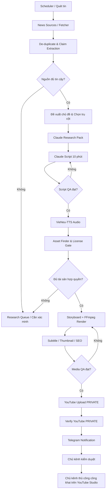

# EV CREATOR STUDIO — MASTER ALL-IN-ONE

**MỘT FILE DUY NHẤT ĐỂ GIAO CLAUDE CODE XÂY DỰNG PHẦN MỀM HOÀN CHỈNH**  
**Phiên bản tài liệu:** 2.0 — 23/11/2026  
**Ngôn ngữ sản phẩm:** Tiếng Việt (giao diện, nội dung, log hướng dẫn cho người vận hành)  
**Đầu ra cần xây:** Mã nguồn chạy được, không chỉ bản thảo hoặc sơ đồ.  
**Trạng thái:** TÀI LIỆU YÊU CẦU; không tuyên bố phần mềm đã được xây dựng.

> **LỆNH GỐC CHO CLAUDE CODE:** Bạn là trưởng nhóm kiến trúc và kỹ thuật chịu trách nhiệm viết phần mềm **EV Creator Studio** thực sự hoạt động. HÃY ĐỌC TOÀN BỘ FILE NÀY TRƯỚC KHI LẬP TRÌNH. File đã gộp đầy đủ: (I) mệnh lệnh thực thi, (II) đặc tả SRS, (III) system/developer prompt viết kịch bản YouTube 10 phút, và (IV) nguyên văn prompt sáng tác do chủ kênh cung cấp. **Không được yêu cầu tìm thêm ba file Markdown cũ hay file .txt gốc**, bởi nội dung của chúng được nhúng ở đây. Khi lập trình hãy tạo file prompt thật bên trong repo ứng dụng từ mục III; không bắt chủ kênh phải nhập lại.

## 0. Thứ tự ưu tiên và quy tắc giải quyết mâu thuẫn

1. **Bất biến an toàn của chủ kênh:** upload YouTube chỉ PRIVATE; không có tính năng tự chuyển PUBLIC/SCHEDULED/UNLISTED; chủ kênh phải tự thay trạng thái trên YouTube Studio; nguồn tin và bản quyền phải được xác minh; không bịa dữ kiện.
2. **Yêu cầu gốc của người dùng hiện tại:** tạo phần mềm nuôi kênh YouTube tại Việt Nam, xoay quanh VinFast/xe điện theo ba trụ cột P1/P2/P3; Claude tự nghiên cứu và viết bài luận tin tức; VieNeu-TTS đọc; tìm tư liệu hợp quyền; tự dựng video; tự tạo SEO/thumbnail; tự upload private và nhắn Telegram.
3. **Mục I — MASTER COMMAND** quyết định cách triển khai, tiến độ, cách báo cáo, cơ chế demo/production.
4. **Mục II — SRS** là nguồn chân lý về tính năng, kiến trúc, data model, bảo mật, tiêu chí nghiệm thu.
5. **Mục III — PROMPT SCRIPT** là nguồn chân lý về lời thoại và JSON đầu ra Claude cho video **10 phút**.
6. **Mục IV — PROMPT NGUYÊN VĂN** là tài liệu gốc được bảo tồn để học văn phong, cơ chế kể chuyện, áp lực/đảo chiều, hình tượng Tam Quốc; KHÔNG làm theo yêu cầu cũ về video ngắn/TikTok hoặc 6.000–7.000 từ khi chúng xung đột với mục tiêu 10 phút, cấu trúc JSON và tính xác thực. Chỉ áp dụng tỷ lệ 55% drama khi chủ đề P3 phù hợp và được nguồn tin chứng minh, không ép vào hướng dẫn kỹ thuật P1/P2.

**Bắt buộc sửa tự động các đường dẫn tham chiếu cũ trong tài liệu khi áp dụng:** những tên `EV_Creator_Studio_Dac_Ta_Ky_Thuat.md`, `EV_Creator_Studio_Prompt_Claude_10_Phut.md`, `EV_Creator_Studio_Master_Prompt_Xay_Dung_Phan_Mem.md`, `PromptPhanTichVideoCuaDoiThu.txt` xuất hiện trong các phần nhúng chỉ là dấu vết tên tài liệu ban đầu. Chúng lần lượt tương đương **Mục II, Mục III, Mục I, Mục IV của CHÍNH FILE NÀY**; không được coi là phụ thuộc file bên ngoài. Bạn phải copy mục III thành `prompts/youtube_script_10min.md` của sản phẩm trong lúc code. Có thể lưu mục IV trong repo để đối chiếu phong cách nhưng không bắt buộc.

## 0.1 Định nghĩa kết quả thực tế

**Mục tiêu E2E production:** Quét tin được phép -> gom nguồn và claim -> xếp hạng theo P1/P2/P3 -> Claude ResearchPack -> Claude tạo lời thoại ~10 phút -> VieNeu sinh WAV có kiểm tra thật -> thu gom asset có phép/đồ họa tự tạo -> render MP4 Full HD, subtitle + thumbnail + SEO -> tải bằng YouTube Data API OAuth vào kênh được chủ kênh chọn với `status.privacyStatus='private'` -> gọi API kiểm tra lại PRIVATE -> Telegram báo chủ kênh -> chủ kênh xem, sửa hoặc thủ công công khai ở YouTube Studio.

**Điều không thể giả lập là đã chạy thật:** Khi không có API key/OAuth/hardware, bạn phải chạy và kiểm thử bằng demo adapters *gắn nhãn DEMO*, không giả rằng đã gọi dịch vụ thật. Không âm thầm bỏ qua media rights gate, fact-check, private check hoặc dùng mock ở production. Demo không upload YouTube thật, không gửi tới kênh thật. Không báo "hoàn thành" cho tính năng chưa qua ít nhất một smoke test tương ứng.

**Ưu tiên thực thi:** Một vertical slice hoạt động đầu-cuối có thể kiểm chứng, rồi mới phát triển theo phase. Không chỉ tạo giao diện đẹp rỗng, sơ đồ, TODO hay boilerplate.

## 0.2 Cơ chế ra quyết định mặc định

- Nếu thiếu API key, OAuth, bot token, ID kênh hoặc quyền media, triển khai giao diện cấu hình, hợp đồng adapter, mock có nhãn và unit/integration test; ghi `BLOCKED_BY_CREDENTIALS` cho nghiệm thu tích hợp thật.
- Nếu thiếu lựa chọn nền tảng, ưu tiên triển khai local-first: Windows 11 + WSL2/Docker Compose hoặc Linux; tách render/TTS worker để sử dụng GPU nếu có, fallback CPU cho VieNeu khi tương thích.
- Không ghi secrets vào prompt, commit, logs hoặc thông báo Telegram; cung cấp `.env.example` không chứa secret. Google OAuth không sử dụng cookie Chrome/YouTube, không cần người dùng đưa mật khẩu tài khoản.
- Claude dùng Anthropic API chính thức; tin nóng lấy qua bộ nguồn hợp lệ + nghiên cứu nguồn có trích dẫn. Không tin kết luận do LLM tự phát biểu nếu không có chứng cứ.
- FFmpeg là renderer tự động chính. CapCut là lựa chọn xuất asset để chỉnh sửa thủ công; không tạo phụ thuộc vào việc hack GUI hoặc CapCut API không xác minh.
- Lấy ảnh từ web chỉ là bước tìm kiếm; asset chưa chứng minh quyền sử dụng phải bị loại. Dùng đồ họa tự tạo khi không tìm được tài sản hợp quyền.
- Lời đọc chỉ xuất từ `spoken_script`. Các trường `production_notes`, `editorial_claim_map`, URLs và timestamp không được đọc lên tiếng.
- Quét tin theo lịch cấu hình được, nhưng không được tự chạy mã sản xuất chỉ vì mở một trang dashboard; mọi job có lịch, checkpoint, trạng thái và lịch sử rõ ràng.

## 0.3 Chỉ dẫn lập trình như một dự án production

**Yêu cầu đầu tiên:** Kiểm tra workspace, tạo `IMPLEMENTATION_PLAN.md`, chọn phiên bản các gói tương thích và triển khai ngay; **đừng chỉ dừng lại sau việc lập kế hoạch**, trừ khi không còn cách phát triển ở môi trường hiện tại. Dùng cấu trúc thư mục mục II/K hoặc tốt hơn có lý do. Đừng sửa repository VieNeu-TTS upstream. Tách phần mềm mới riêng, adapter hóa các phụ thuộc.

**Vòng làm việc bắt buộc mỗi phase:**
- Viết mã có type hints, schema validation, migration, logs và test.
- Chạy thực tế lệnh cài/build/test trong môi trường hiện có; ghi kết quả PASS/FAIL/NOT_TESTED (không đoán).
- Ghi những module, routes, tables, file và những tích hợp đã làm thật; có lệnh chạy lại tối thiểu cho chủ kênh.
- Nếu test lỗi, sửa rồi chạy lại; nếu blocked, chỉ ra chính xác điều kiện nào còn thiếu và giữ giải pháp demo an toàn.
- Không sửa thẳng file `.env` có secret do chủ kênh cung cấp; không tải model weights hoặc media hàng GB một cách tự ý nếu chưa có điều kiện hạ tầng hoặc quyền.

**Các worker tối thiểu:** `NewsIngestionJob`, `FactCheckJob`, `ResearchJob`, `ScriptJob`, `TTSJob`, `MediaJob`, `StoryboardJob`, `RenderJob`, `SEOJob`, `UploadPrivateJob`, `NotifyTelegramJob`, `RefreshStatusJob`. Có retry exponential backoff, giới hạn concurrency, replay an toàn và khóa idempotency theo job/story/channel.

**Luồng trạng thái:** dựa trên state machine mục II/L. Backend phải chặn mọi đường đi vào upload khi QA chưa PASS, khi claim chính yếu chưa VERIFIED, khi asset thiếu license, khi OAuth channel mismatch hoặc khi người vận hành chưa cho phép bắt đầu Autopilot Private.

**Phân biệt ba loại duyệt:** (a) xác minh tin/claim để được phép sản xuất; (b) media QA đủ điều kiện upload RIÊNG TƯ; (c) chủ kênh kiểm duyệt video cuối qua Telegram/dashboard trước khi tự công khai. (a), (b) là các gate biên tập tự động hoặc thủ công; (c) không kích hoạt public tự động.

## 0.4 Đầu ra và báo cáo phải có

1. Repo đầy đủ `backend/`, `frontend/`, `workers/`, `prompts/`, `tests/`, `migrations/`, `docker-compose.yml`, `.env.example`, `README.md`, `IMPLEMENTATION_PLAN.md` và công cụ demo offline.
2. API/UI phải hoạt động thật hoặc có nhãn mock phân biệt tuyệt đối với dữ liệu thật.
3. Có một bộ fixture đầy đủ P1/P2/P3, có claim hợp lệ, nguồn thiếu, URL trùng, asset chưa có phép, upload lỗi và notify lỗi để chứng minh các gate.
4. Giao diện: Tin nóng/điểm số; Biên tập & chứng cứ; Audio; Timeline/Assets; Preview+SEO+YouTube private; Telegram review; thiết lập tài khoản; Analytics (read-only khi có quyền).
5. Script runtime để kiểm tra integrity và privacy (`ffprobe`, hashes, YouTube privacy readback) và test private policy chống bất kỳ tham số khác `private`.
6. Quy trình OAuth kết nối đúng kênh; lúc upload backend xác nhận danh tính channel đã cấp quyền; khi không khớp thì chặn.
7. Hướng dẫn khởi chạy local, môi trường CPU/GPU, backup, gia hạn token, recovery khi mạng lỗi và ước tính tiêu hao dịch vụ được ghi rõ.
8. Bảng nghiệm thu cuối có các cột: `requirement`, `implementation_path`, `test_command`, `test_result`, `external_credentials_needed`, `notes`.

## 0.5 Điều kiện hoàn thành (Definition of Done)

- **Không auto-public:** không endpoint/hành động `publish`, `privacyStatus=public`, hoặc job tự đặt lịch công khai. Telegram click `Đã duyệt` chỉ cập nhật `APPROVED_PRIVATE` trong DB.
- **Tin tức có chứng cứ:** mỗi fact định lượng/nhạy cảm có URL, ngày, `claim_id`; kiểm tra tín nhiệm và độ mới trước upload; nguồn không xác minh thì không tạo video.
- **Kịch bản đúng thời lượng:** chuẩn ~10 phút sau khi đo duration WAV thực tế, không ép từ cũ 6.000–7.000 từ; có sửa riêng từng đoạn và traceability của claim.
- **Video có tác phẩm mới:** có phân tích, câu chuyện, đồ họa độc lập, không chỉ sao chép bài báo + slideshow; tư liệu đã kiểm quyền.
- **Upload/private/Telegram:** real workflow có thể được vận hành khi chủ kênh cung cấp key và cho phép OAuth; retry không đăng trùng; nếu chưa có quyền thì nghiệm thu đánh dấu CHƯA KIỂM THỬ THẬT.
- **Đã thử lỗi:** mô phỏng mất mạng upload, sai tài khoản, claim bị tranh cãi, hình chưa rõ giấy phép, lỗi TTS và bot Telegram mất kết nối mà không làm lộ key/đổi privacy.

## 0.6 Bắt đầu ngay

> **CLAUDE CODE: Hãy bắt đầu xây phần mềm dựa trên TOÀN BỘ FILE NÀY.** Đầu tiên đọc mục I, II, III, IV; sau đó tạo `IMPLEMENTATION_PLAN.md`, khởi tạo workspace, triển khai code theo thứ tự, chạy test và ghi bàn giao. Không hỏi lại những yêu cầu đã được định nghĩa ở đây. Chỉ yêu cầu chủ kênh cung cấp keys/authorization tại bước nối dịch vụ thật. Tuyệt đối không trả lời bằng một bản đặc tả mới thay vì code.

---

# MỤC I — MASTER COMMAND TRIỂN KHAI (TỪ TÀI LIỆU MASTER GỐC)

# PROMPT GIAO CLAUDE CODE XÂY PHẦN MỀM EV CREATOR STUDIO

Bạn là **Senior Software Architect, Python/TypeScript Full-stack Engineer, Video Pipeline Engineer, AI Engineer và YouTube API Integrator**. Hãy tạo một ứng dụng chạy thật tên **EV Creator Studio** dựa **đầy đủ** trên **Mục II (SRS)** và **Mục III (prompt viết bài)** của CHÍNH FILE NÀY. Không được coi hai file này chỉ là ý tưởng tham khảo; phải triển khai chức năng tương ứng, ghi rõ tính năng nào đã chạy và chưa chạy.

## NHIỆM VỤ

Xây dựng một ứng dụng web cho chủ kênh YouTube tại Việt Nam. Hệ thống tự quét tin xe điện/VinFast, chấm điểm, kiểm chứng, tự đề xuất/chọn chủ đề phù hợp P1/P2/P3 khi bật Autopilot, gọi Anthropic Claude API tạo luận giải thích & bình luận ~10 phút, gọi VieNeu-TTS (https://github.com/pnnbao97/VieNeu-TTS) để sinh giọng đọc, thu thập tư liệu có quyền, dựng video 1080p bằng FFmpeg, tạo thumbnail/SEO, tự động upload lên kênh bằng YouTube OAuth ở trạng thái **PRIVATE**, xác minh private, sau đó gửi thông báo Telegram. Chủ kênh nghe/xem, yêu cầu sửa hoặc tự mở YouTube Studio để công khai. **TUYỆT ĐỐI không tạo hành động tự công khai trong ứng dụng.**

## YÊU CẦU QUAN TRỌNG

1. Đọc toàn bộ **Mục II, Mục III** trong file này **trước khi viết mã**. Đọc cả **Mục IV — prompt gốc** để giữ chất giọng văn; prompt mới là phiên bản triển khai cho video 10 phút.
2. Kiểm tra tài liệu hiện hành của repo VieNeu-TTS (README.vi.md, pyproject.toml, examples) để chọn version hoạt động. Không sửa, push hoặc fork upstream nếu chưa có yêu cầu.
3. Dùng FastAPI + Pydantic + PostgreSQL + Redis/Celery cho backend, Next.js + TypeScript cho frontend, FFmpeg để render, Anthropic API, VieNeu SDK/API, Google OAuth/YouTube Data API v3, Telegram Bot API. Docker Compose hoặc hướng dẫn Windows + WSL2 rõ ràng.
4. Có **hai chế độ**: `MANUAL` (người dùng chọn chủ đề) và `AUTOPILOT_PRIVATE` (chạy end-to-end đến YouTube private nếu vượt ngưỡng tin cậy). Autopilot **dừng** khi thiếu nguồn, thiếu tư liệu bản quyền, sai thời lượng hoặc QC không đạt.
5. Thiết kế state machine, audit log, job checkpoints, retries và idempotency. API key/token trong env/secrets, không rò trong log hoặc repo. Không click/điều khiển trình duyệt để thay OAuth upload.
6. Source và fact-check: mỗi claim quan trọng có URL nguồn + ngày; không bịa giá, chính sách trạm sạc hay luật. Chặn tin không đủ căn cứ. Đọc từ nguồn hợp lệ; không crawl vượt paywall hoặc vượt điều khoản.
7. `spoken_script` sạch để đưa TTS; xuất ra JSON riêng cho `production_notes`, cảnh và metadata. TTS duration đo bằng file audio thật; điều chỉnh script đến khoảng 600–720s, **không bao giờ dưới 600s (10 phút)**.
8. `asset_licenses` là dữ liệu bắt buộc. **Không tự lấy ảnh Google** và dùng lên video nếu không có quyền. Có fallback đồ họa nội bộ.
9. Upload phải đặt `status.privacyStatus='private'` rõ ràng và đọc lại bằng `videos.list`. Trạng thái private và tên kênh phải hiện trong UI trước upload. Không tự đổi privacy dù Telegram gửi nút "Đã duyệt".
10. Telegram gửi nội dung video, tiêu đề, video ID, trạng thái private, ngày nguồn và link review có bảo vệ. Lỗi Telegram không làm video công khai.
11. Không đánh dấu "đã hoàn thành" cho tính năng chỉ có UI mock. Nếu dịch vụ bên thứ ba chưa có khóa, cung cấp **demo/mock mode có nhãn** và chỉ dẫn tích hợp thật.
12. Kiểm thử đầy đủ: unit tests, integration tests với mock bên ngoài, end-to-end smoke test trên input demo, test giả lập mất mạng lúc upload, test policy forcing private, test license gating, test thiếu citation và duplicate upload.

## THỨ TỰ THỰC HIỆN

**Bước 1: Khảo sát và kế hoạch.** Đọc file, xem môi trường và phụ thuộc đã có. Viết `IMPLEMENTATION_PLAN.md`: hệ thống, rủi ro, package, DB schema, API routes, thứ tự triển khai. Liệt kê thông tin phải do người dùng tự cung cấp: Anthropic API key, Google OAuth client, channel ID và scope, Telegram bot token/chat ID, nguồn media hợp quyền, lựa chọn máy CPU/GPU. Những mục chưa có thì làm demo mode; không bịa credentials.

**Bước 2: Backend + database.** Migrations, source/news/fact models, job orchestration và endpoints. Tạo dữ liệu mẫu offline để test.

**Bước 3: Claude writer.** Đọc prompt mới từ file thay vì hard-code trong Python, ResearchPack structured, script generated schema validated, sửa từng đoạn, ghi version và claim map.

**Bước 4: VieNeu-TTS.** Cài thư viện/worker tách biệt, adapter với `.infer()/.save()` hoặc server `/v1/audio/speech`, mẫu thử nghe 30s, ghép full, đo duration, cache segments; xử lý Windows/Linux. Có fallback thông báo rõ nếu thiếu model weights.

**Bước 5: Assets & render.** Media licensing gate, Pexels/Wikimedia/own-library adapters, graphics tự tạo, storyboard, FFmpeg 1080p, subtitle, thumbnail và render QC.

**Bước 6: YouTube & Telegram.** Google OAuth flow, chọn kênh, upload resumable to PRIVATE, verification, thông báo Telegram, button mở Studio/revision. Test chống duplicate/không bao giờ công khai.

**Bước 7: Frontend.** 6 màn hình: Dashboard, Tin tức, Script Editor, Timeline/Media, Review & Upload, Analytics/Settings. Có preview phát media, nguồn claim, trạng thái thực.

**Bước 8: Tests, docs và deploy.** `.env.example`, `README.md`, `docker-compose.yml`, migrations, `make test` hoặc lệnh tương đương, scripts smoke. Viết checklist nghiệm thu; đánh dấu từng tiêu chí `PASS`, `FAIL`, `NOT_TESTED` dựa trên test thật.

## TIÊU CHÍ BÀN GIAO

- Sau khi cung cấp key hợp lệ và OAuth, tôi có thể bật Autopilot để hệ thống tự tìm 1 tin đáng làm, viết, đọc, dựng, tải lên kênh **RIÊNG TƯ**, nhắn Telegram.
- Khi key chưa có, chạy được full luồng demo với dữ liệu đã kiểm chứng giả lập được gắn nhãn DEMO, không có upload thật.
- Dashboard thể hiện tin gốc, link nguồn, audio, MP4, thumb, mô tả, trạng thái upload, id YouTube, lịch sử retry và báo cáo lỗi.
- Mọi yêu cầu sửa trong review có tạo bản mới, không tự xóa hay công khai bản cũ.
- Repo mới phải dễ duy trì, type-safe khi có thể, file lệnh rõ ràng, logging/audit, secrets-safe.

**Cách báo cáo:** Sau mỗi phase, ghi file đã thêm/sửa, lệnh test đã chạy, kết quả thực tế, hạn chế còn tồn tại. Không tự nói "100% hoạt động" nếu chưa chạy integration với credential thật. Nếu task quá lớn để hoàn thành một lần, ưu tiên triển khai một lát cắt hoạt động thật end-to-end trước, rồi phát triển dần theo phase, nhưng **không bỏ qua kiểm tra private, nguồn và bản quyền**.

---

# MỤC II — ĐẶC TẢ SẢN PHẨM VÀ KỸ THUẬT CHI TIẾT (SRS)

# EV CREATOR STUDIO — ĐẶC TẢ SẢN PHẨM VÀ KỸ THUẬT (SRS)

**Phiên bản:** 1.0 — 23/11/2026  
**Phạm vi:** Công cụ tự động hóa sản xuất video YouTube dài 10 phút về xe điện, VinFast và hệ sinh thái xe điện tại Việt Nam.  
**Đầu vào biên tập:** Mục IV trong cùng file (nguyên văn `PromptPhanTichVideoCuaDoiThu.txt` do chủ kênh cung cấp).  
**TTS:** https://github.com/pnnbao97/VieNeu-TTS (mã nguồn mở VieNeu-TTS v3 Turbo, không phải v4 độc quyền).  
**Trạng thái:** Bản thiết kế để giao Claude/Claude Code lập trình. Đây **chưa phải phần mềm đã được xây dựng/chạy thử**.

## A. Tóm tắt sản phẩm và các nguyên tắc bắt buộc

EV Creator Studio là "tòa soạn video AI có người duyệt cuối". Phần mềm phát hiện tin nóng, chọn đề tài phù hợp người xem Việt Nam, kiểm chứng nguồn, viết luận giải thích + bình luận bằng Claude, đọc bằng VieNeu-TTS, tự tìm tư liệu hợp quyền sử dụng, dựng 16:9 Full HD, làm metadata SEO + thumbnail và tải lên kênh YouTube đã **cấp quyền OAuth** ở chế độ `private`. Bot Telegram nhắn chủ kênh; **không tự động công khai**. Người dùng tự đổi sang Công khai trên YouTube Studio sau khi kiểm duyệt.

**Bất biến an toàn, không được phép cấu hình tắt trong phiên bản đầu:**
1. `video.status.privacyStatus = 'private'` trong mọi lệnh upload; kiểm tra lại trạng thái sau khi tải lên. Không có lệnh hoặc nút tự động publish công khai trong MVP.
2. Không sử dụng tài sản hình ảnh/clip chỉ vì "tìm được trên mạng"; mỗi asset phải có bằng chứng quyền dùng hoặc bị loại.
3. Không xuất bản khi chưa xác minh các khẳng định trọng yếu về giá, pin, bảo hành, thời hạn ưu đãi, số lượng trạm, thông tư/quy định; không bịa sự kiện/số liệu/trích dẫn.
4. Không giả là kênh chính thức của VinFast; nhận diện kênh độc lập, không mạo danh; không tạo hình/clip giả như quay trực tiếp một sự kiện thật.
5. Không sản xuất nội dung hàng loạt chỉ bằng mẫu rập khuôn. Mỗi video cần góc nhìn, lập luận và đồ họa do hệ thống xây mới cho chủ đề đó; có checkpoint biên tập của con người.
6. Người dùng chọn *kênh đích chính xác* khi liên kết OAuth; không dùng cookie trình duyệt để giả định quyền đăng nhập API.

## B. Chân dung khán giả và chiến lược nội dung

### Ba trụ cột cố định

| Mã | Nhóm | Khán giả chính | Hứa hẹn giá trị | Tỉ trọng khởi đầu |
|---|---|---|---|---|
| P1 | Giải đáp nỗi lo trước khi mua xe lần đầu | Người đổi từ xe xăng sang xe điện, gia đình mua xe đầu tiên | Ra quyết định sáng suốt, dựa trên tình huống và chi phí thật | 40% |
| P2 | Mẹo sử dụng và tối ưu chi phí | Chủ xe điện đang sử dụng, người chạy dịch vụ | Tiết kiệm thời gian, năng lượng, chi phí; an toàn | 35% |
| P3 | Trạm sạc, thị trường, chính sách mới | Chủ xe, người mua, người theo dõi VinFast/EV | Hiểu điều gì thực sự thay đổi và tác động ra sao | 25% |

Tỉ trọng là gợi ý khởi động, điều chỉnh từ retention, click-through, bình luận sau 30 ngày. Không dùng số lượng view một mình để tối ưu.

### Ngân hàng ý tưởng và **mỗi ý tưởng có một tiêu đề gợi tò mò nhưng không khẳng định sai**

**P1 — Người chuẩn bị mua xe:**
1. Tính tổng chi phí sở hữu 3 năm theo quãng đường và cách sạc. **Tiêu đề:** "Mua VinFast lần đầu: Số tiền phải tính không chỉ là giá xe?"
2. Nhà chung cư không có sạc riêng. **Tiêu đề:** "Ở chung cư không có trụ sạc: Mua ô tô điện có thực sự bất tiện?"
3. Khác biệt quãng đường công bố và quãng đường thực tế. **Tiêu đề:** "Vì sao một lần sạc có thể đi ít hơn bạn hình dung?"
4. Những câu hỏi phải hỏi khi nhận bàn giao xe. **Tiêu đề:** "Nhận xe điện lần đầu: Có 7 câu hỏi rất dễ quên"
5. Kịch bản về quê/đi đường dài. **Tiêu đề:** "Đi xa bằng VinFast: Điều gì quan trọng hơn dung lượng pin?"
6. Mua xe cũ, tình trạng pin và lịch sử dịch vụ. **Tiêu đề:** "VinFast cũ có đáng cân nhắc? Hãy xem điều này trước khi đặt cọc"

**P2 — Chủ xe hiện tại:**
1. Tối ưu lộ trình sạc và giờ xuất phát. **Tiêu đề:** "Sạc thế nào để bớt thời gian chờ mà không phải đổi lịch cả ngày?"
2. Ảnh hưởng tốc độ, điều hòa, tải trọng đến năng lượng. **Tiêu đề:** "Cùng một chiếc xe điện, vì sao hai người lại tốn điện khác nhau?"
3. Quản lý pin theo khuyến nghị từng dòng xe. **Tiêu đề:** "Có nên ngày nào cũng sạc đầy 100%? Câu trả lời phụ thuộc vào đâu?"
4. Chi phí thực tế khi chạy đô thị/dịch vụ. **Tiêu đề:** "Đi xe điện trong phố: Khoản chi nào dễ bị bỏ sót nhất?"
5. Đọc dữ liệu tiêu thụ điện từ xe và app. **Tiêu đề:** "Con số trên màn hình xe đang nói gì về cách lái của bạn?"
6. Khi trạm sạc đông hoặc gặp sự cố. **Tiêu đề:** "Đến trạm sạc mà không sạc được: Nên kiểm tra điều gì trước?"

**P3 — Hạ tầng/chính sách/xu hướng:**
1. Tin mở rộng mạng lưới trạm sạc khi có công bố xác thực. **Tiêu đề:** "Trạm sạc VinFast đang mở rộng: Người dùng thực sự được lợi ở đâu?"
2. Phân tích ưu đãi sạc theo thời hạn và điều kiện áp dụng. **Tiêu đề:** "Ưu đãi sạc nghe rất hấp dẫn: Có điều kiện nào cần đọc kỹ?"
3. Phân biệt công bố hợp tác, kế hoạch, triển khai, vận hành. **Tiêu đề:** "Công bố thêm trạm sạc có đồng nghĩa đã sạc được ngay?"
4. Ảnh hưởng chính sách mới đến người mua xe. **Tiêu đề:** "Quy định xe điện mới: Ai bị ảnh hưởng và từ ngày nào?"
5. Mô hình sạc tại nhà và sạc công cộng. **Tiêu đề:** "Tương lai xe điện ở Việt Nam sẽ nghiêng về sạc nhà hay sạc công cộng?"
6. Cạnh tranh về hệ sinh thái sạc (khi có dữ liệu). **Tiêu đề:** "Cuộc đua xe điện có thể được quyết định ở trạm sạc thay vì showroom?"

Các tiêu đề trên là **đề xuất evergreen**, không tuyên bố đã xảy ra sự kiện cụ thể. Khi phát hiện tin mới, hệ thống bắt buộc cập nhật điều kiện, ngày, model, địa phương và số liệu từ nguồn trước khi chốt tiêu đề.

### Quy tắc chọn đề tài từ tin nóng

Mỗi lần quét, tạo 1–20 `NewsCandidate`; không làm video theo mọi tin. Xếp hạng `/100`:
- Độ mới và diễn biến thực tế (0–20).
- Tác động với khán giả 3 nhóm (0–25).
- Mức xác thực, chất lượng nguồn (0–25).
- Khả năng giải thích dưới góc nhìn khác tin gốc (0–15).
- Khả năng kiếm hình ảnh hợp quyền và triển khai video 10 phút (0–10).
- Tính mới so với video đã làm (0–5).

Quy tắc đề xuất: >= 75 vào shortlist; 60–74 chờ nghiên cứu; <60 lưu làm tham khảo. Trừ điểm hoặc chặn nếu tin dựa trên đồn đoán, thiếu nguồn gốc hoặc tiêu đề câu kéo không có cơ sở. Dedupe theo `canonical_url`, sự kiện, xe/model, ngày hiệu lực và semantic similarity. Tin nóng không đồng nghĩa tin đáng đăng.

### Tần suất

MVP mặc định quét tin 3 giờ/lần; tạo shortlist mỗi sáng; dựng không quá 3 video dài/tuần để đủ kiểm duyệt. Chủ kênh chỉnh tần suất. Có **hai chế độ**: `MANUAL` cho người dùng tự chọn đề tài; `AUTOPILOT_PRIVATE` tự chọn tin có điểm >= 80/100, đủ chứng cứ và đủ nguồn tư liệu hợp quyền, rồi tự chạy toàn bộ chuỗi đến upload riêng tư + Telegram. Nếu thiếu bất kỳ điều kiện nào hệ thống chuyển hàng đợi chờ duyệt/đối chiếu, không bịa dữ kiện để đạt số lượng. Có chế độ “Tin nóng” tạo đề xuất ngay nếu tin có nguồn chính thức và tác động rõ, nhưng vẫn không được tự công khai.

## C. Nghiên cứu và kiểm chứng tin

**Nguồn ưu tiên**: (1) thông báo và tài liệu gốc VinFast, V-Green, nguồn Chính phủ/Cổng thông tin văn bản pháp luật, cơ quan chức năng, báo cáo công bố; (2) báo chí uy tín và nguồn tin độc lập; (3) thảo luận cộng đồng chỉ làm đầu mối hoặc mô tả trải nghiệm, không làm chứng cứ chung cho toàn bộ người dùng. Nguồn thông cáo doanh nghiệp là nguồn tin về *tuyên bố của doanh nghiệp*, không tự động chứng minh lợi ích/hiệu quả thực tế.

Ví dụ đầu mối: `vinfastauto.com/vn_vi/tin-tuc`, `vgreen.net/vi/tin-tuc`, `vgreen.net/vi/tin-tuc/chinh-sach`, văn bản cơ quan quản lý. Lấy qua RSS/API hợp lệ khi có; fallback scraper tôn trọng robots, điều khoản, giới hạn tốc độ và bản quyền; không vượt paywall. Hệ thống cho phép admin quản lý `allowed_sources` và `blocked_sources`.

Mỗi tin lưu: `id`, `title`, `url`, `canonical_url`, `publisher`, `published_at`, `fetched_at`, `observed_at`, `event_at`, `effective_from`, `effective_to`, `raw_excerpt`, `article_hash`, `language`, `model_names`, `entities`, `supporting_sources`, `contradictions`, `trust_tier`.

**Bộ xác minh 2 lớp:**
1. Trích xuất `Claims` từ bài viết: mỗi claim chỉ có 1 ý kiểm tra, có `claim_type`, `value`, `unit`, `date_scope`, `source_url`, `evidence_excerpt`, `status` (`verified`, `unverified`, `contested`, `inference`).
2. Các claim nhạy cảm (giá bán, ưu đãi sạc, bảo hành, cấu hình xe, kết luận an toàn, lượng xe bán, số trạm đang hoạt động, luật có hiệu lực) cần nguồn gốc cấp một hoặc ít nhất hai nguồn đáng tin độc lập. Nếu xung đột, hiển thị **[CẦN XÁC MINH]** trong màn biên tập và khóa dựng/upload cho đến khi loại bỏ claim hoặc sửa.

**Thời điểm:** luôn lưu ngày đăng tin, ngày diễn ra sự kiện, ngày bắt đầu/kết thúc chính sách (chúng khác nhau). Trước khi render và upload phải chạy `freshness_check` cho các claim có thể thay đổi. Luận điểm dự báo phải gắn `[PHÂN TÍCH/KỊCH BẢN]`. Không viết "hôm nay" nếu không rõ múi giờ và ngày.

## D. Sinh bài viết bằng Claude — thiết kế 2 bước

**Yêu cầu kỹ thuật**: dùng Anthropic API (API key riêng), không giả định đăng ký Claude giao diện web cung cấp quyền API. Model name được cấu hình theo loại model hợp lệ tại thời điểm chạy, không hard-code phiên bản không được cấp quyền. Hỗ trợ Claude Web Search tool khi tài khoản API cho phép; tuy nhiên ưu tiên `ResearchPack` do hệ thống đã thu thập, để khóa nguồn và tái lập kịch bản.

**Bước 1 — ResearchPack:** Claude nhận tin, claim, nguồn, video đã đăng, nhóm khán giả; trả về JSON có `editorial_angle`, `why_now`, `what_changed`, `counterarguments`, `risk_notes`, `source_ids`, `recommended_pillar`, `hook_options`, `video_unique_value`. Không viết kịch bản nếu claim quan trọng `unverified`.

**Bước 2 — Kịch bản lời đọc:** Claude nhận `ResearchPack`, phiên bản prompt người dùng và quy tắc biến thể theo trụ cột. Sinh `spoken_script` dài **khoảng 1.300–1.600 từ** làm mục tiêu ban đầu; đo bằng giọng TTS thực tế để khớp 9:30–10:30; nếu vượt/thiếu thì yêu cầu viết lại phù hợp. Kịch bản liền mạch, đoạn 2–5 câu, không chèn chỉ đạo dựng phim vào lời đọc. Tạo `production_manifest` **riêng** (không đưa vào spoken_script) cho cảnh, tư liệu, phụ đề và nguồn.

**Kế thừa prompt gốc** (không mất chất giọng): Tam Quốc hiện đại **chỉ sử dụng cho video phân tích chiến lược/thị trường nếu có xung đột thật**; 55% xung đột chỉ là định hướng **cho loại video phân tích doanh nghiệp**, không áp cho video kỹ thuật/hướng dẫn. Hook 0–30 giây bằng nghịch lý có căn cứ; nhịp kéo 30–60 giây; đảo chiều khoảng 2–3 phút; 3–4 vòng câu hỏi mở được đóng trước cuối; kết luận cân bằng, CTA ngắn. Không bịa đối thủ phản công nếu không có chứng cứ; chỉ phân tích khả năng theo điều kiện.

**Riêng từng nhóm:**
- P1: ưu tiên câu hỏi mua hay không, tình huống thật, ví dụ tính chi phí có giả định được công khai, bảng checklist.
- P2: ưu tiên hướng dẫn có thể thực hành, nêu rõ đời xe/phiên bản, an toàn và hướng dẫn chính thức; không tự đưa quy trình sửa chữa/hack pin.
- P3: ưu tiên sự kiện + ngày hiệu lực + nguồn gốc + 2 luồng quan điểm + tác động chủ xe; tách MOU, kế hoạch, xây dựng, nghiệm thu, vận hành.

**Quality gates** (mặc định):
- Có hook thật sự trả lời được trong video, không phóng đại.
- 100% claim quan trọng gắn ít nhất một `source_id`; tất cả số liệu có ngữ cảnh ngày/đơn vị.
- `originality_check`: không chép dài nội dung nguồn; chỉ tóm tắt và đưa phân tích tự viết.
- `repetition_check`: không trùng các đoạn/khung hình với video gần đây.
- `duration_estimate` qua TTS: tối thiểu 600 giây (cứng, không được dưới 10 phút), mục tiêu 660 giây, tối đa 720 giây.
- Có 3 lựa chọn tiêu đề; không tự nhận định "VinFast sắp phá sản", "cấm xe xăng", "miễn phí vĩnh viễn" nếu nguồn không hỗ trợ.
- Không khẳng định cảm giác lái, tiêu thụ điện và khoảng chạy là định lượng phổ quát từ một trải nghiệm cá nhân.

**Kịch bản giao Claude**: xem Mục III trong cùng file này (đã nhúng đầy đủ prompt).

## E. TTS VieNeu — tích hợp theo repo thực tế

**Đã kiểm tra trong repo (nhánh `main` tại thời điểm lập tài liệu)**: `pip install vieneu`, `from vieneu import Vieneu`, `Vieneu().infer(text, voice=...)`, `.save(audio, path)`, `.list_preset_voices()`. v3 Turbo hỗ trợ 48 kHz, mặc định chạy CPU qua ONNX Runtime hoặc GPU CUDA khi cấu hình; cũng có server `uv run python -m apps.openai_speech` cung cấp `POST /v1/audio/speech`. Xem `README.vi.md` và `examples/openai_speech_client.py`. v4 giới thiệu trên website là bản độc quyền, **không nằm trong repo mở**.

**Kiến trúc adapter:** `TTSProvider` interface có `synthesize(chunks, voice_id, config) -> AudioManifest`; adapter `VieNeuLocalAdapter` gọi Python SDK; `VieNeuHttpAdapter` gọi API cục bộ khi cần tách tiến trình. Không sửa trực tiếp source trong repo upstream, pin tag/commit hoặc version package đã được smoke-test. Khởi tạo model một lần cho mỗi worker.

**Pipeline:** chuẩn hóa tiếng Việt và thuật ngữ (`VinFast`, `VF 3`, `V-Green`, `kWh`, `km`, số tiền/ngày tháng), chia theo dấu câu/đoạn (không cắt giữa từ), giữ `segment_id`, sinh WAV từng đoạn, soát im lặng và ngưỡng âm lượng, ghép với pause tự nhiên, đo tổng thời gian qua `ffprobe`, QC lỗi phát âm, peak/clipping, đoạn rỗng. Lưu mapping `script_segment -> audio_start/end` phục vụ subtitle và storyboard. Khi sửa một đoạn văn chỉ tái tổng hợp đoạn liên quan, không chạy cả video.

**Preset mặc định:** cho chọn 25 giọng sẵn có qua API của repo; gợi ý thử giọng nam thuyết minh `Hải Đăng` hoặc `Quang Sơn` và so sánh bằng đoạn mẫu trước khi chốt. `style` của v3 Turbo đã bỏ tác dụng nên **không** xây UI cho tham số `style` cũ. Chức năng clone giọng chỉ mở khi người dùng chứng nhận họ sở hữu/được phép dùng giọng mẫu.

**Lưu ý kỹ thuật:** mỗi đoạn cần có fallback retry, cache theo `(text_hash, voice, model_version)`; audio file immutable. Tránh ghép fade tùy tiện gây mất phụ âm; chỉ đặt khoảng nghỉ 100–350ms nếu âm thanh không bị cắt. Kiểm tra phát âm tiếng Việt bởi con người ở bản nháp đầu tiên và khi model/voice thay đổi.

## F. Kho hình và video có quyền sử dụng

Module `AssetFinder` tìm trên: thư viện ảnh/video do chủ kênh tải lên; tài sản được cấp phép; Pexels API; Wikimedia Commons có license tương thích; ảnh báo chí/media kit **chỉ khi quyền sử dụng rõ ràng**. Với hình trên Google Images/web search, chỉ lấy URL phục vụ tìm nguồn gốc, **không tự động tải và sử dụng**. Không lấy ảnh bài báo rồi tự tuyên bố "fair use".

Mỗi asset: `asset_id`, `source_url`, `creator`, `downloaded_at`, `license_name`, `license_url`, `allowed_commercial`, `attribution_text`, `attribution_required`, `permission_proof`, `model`, `year`, `scene_description`, `content_hash`, `local_path`, `review_status`, `is_ai_generated`, `is_illustration`.

**Chặn sai mẫu xe:** Vision kiểm tra hình có tương ứng mẫu xe đã nêu (`VF 3`, `VF 5`, `VF 6` ...); nếu không chắc -> chỉ dùng cảnh chung và dán nhãn minh họa, không ghép như ảnh thật của mẫu xe. Không tự tạo lại biển số cá nhân, con người nổi tiếng hoặc dựng ảnh một vụ tai nạn/sự kiện như đã xảy ra. Ảnh tạo bởi AI được đánh dấu `minh họa` trong ngữ cảnh cần thiết.

**Storyboard tự động:** từ audio timeline thành cảnh dài 4–12 giây, thay đổi góc/di chuyển nhẹ không gây mỏi mắt, đồ họa riêng (biểu đồ chi phí, bảng giả định, đường thời gian ưu đãi, bản đồ sơ đồ — không dùng bản đồ giả làm dữ liệu trực tiếp). Mỗi câu số liệu chính phải xuất hiện dạng text chính xác và có nguồn trong credits/mô tả. Nếu thiếu ảnh thật, dùng đồ họa do mình tạo thay vì lấp bằng ảnh không có phép.

**Tỉ lệ tư liệu gợi ý:** 45% hình/clip hợp quyền, 30% đồ họa số liệu giải thích, 15% ảnh/sơ đồ tự dựng, 10% cảnh thương hiệu/giao diện (chỉ khi được dùng). Đây là gợi ý chứ không phải quy tắc cứng.

## G. Render engine, CapCut và đầu ra video

**Phương án mặc định (MVP):** FFmpeg + Python tạo đồ họa (Pillow/SVG/Matplotlib tùy tác vụ), phụ đề `.srt` + `.ass`. Có thể dùng Remotion cho các template chuyển động phức tạp ở giai đoạn 2. Không phụ thuộc vào CapCut để render hàng loạt, vì tại thời điểm đặc tả không có API biên tập/video rendering công khai đáng tin cậy cho pipeline headless. CapCut chỉ là nhánh xuất media + timeline hướng dẫn hoặc cho phép người dùng mở/chỉnh tay; **không cam kết nhập project CapCut tương thích tự động**.

**Thông số mặc định:** H.264/AAC, MP4, 1920×1080, 16:9, 30fps, `yuv420p`, audio 48kHz; tùy chọn 4K khi có tài sản đủ nét. Trộn music bản quyền hợp lệ ở mức thấp hơn giọng. Intro 0–3s tùy video; không ép logo dài. Caption từ lời đọc đã duyệt, không lấy timestamp theo ước lượng chữ: sử dụng forced alignment hoặc timestamp TTS để căn lại. Cho phép xem trước 360p và render chính thức 1080p.

**Các kiểu cảnh:** ảnh thật + Ken Burns; b-roll hợp quyền; bảng giá/so sánh; công thức tính chi phí với giả định; timeline sự kiện; quote có nguồn; sơ đồ tương tác; cột "Lợi ích / Rủi ro". Mỗi video phải có ít nhất một đồ họa hoặc phép so sánh tự xây (tránh chỉ là slideshow đọc báo).

**Chuỗi QA:** ảnh đúng mẫu xe, clip còn quyền, duration 9:30–10:30 nếu mode `exact_10min`, không đen hình > 0.5s, không đứng hình vô cớ >12s, nhạc không át voice, không lỗi font tiếng Việt, audio không clipping, các asset được license-check, nguồn hiển thị đúng, thumbnail đúng chuẩn, file upload có mã checksum SHA-256.

## H. SEO, thumbnail và tối ưu kênh

Claude tạo 3 tiêu đề cho mỗi video theo 3 công thức: (1) Nghịch lý, (2) Câu hỏi thực dụng, (3) Thay đổi có điều kiện. Chỉ 1 tiêu đề được chọn để upload, vẫn lưu 2 phương án để A/B thủ công. Tiêu đề chứa từ khóa thực (VinFast, xe điện, trạm sạc, pin, mẫu VF...), tò mò mạnh nhưng nội dung phải giải đáp đúng câu hỏi. Không khẳng định tin mới khi chỉ là giả định.

Mô tả: 2 dòng đầu tóm tắt giá trị; mô tả đầy đủ, 3–6 timestamp chương (nếu cần), nguồn tham khảo chính với URL/ngày truy cập, thông tin minh họa/ước tính, CTA bình luận, playlist liên quan, hashtag liên quan (không nhồi). Tự tạo tags và tên file dễ tìm, song tránh coi tags là chiến thuật SEO chính.

Thumbnail 1280×720 hoặc kích cỡ hỗ trợ tương ứng: mẫu VinFast đúng thực tế; 2–5 từ chữ lớn; cảm xúc tò mò lấy từ *nghịch lý thật*; có thể làm 2 biến thể, lưu template thương hiệu và preview trên mobile. Không sử dụng ảnh rò rỉ không kiểm chứng/biểu cảm người thật giả.

**Bộ vòng lặp tối ưu có điều kiện:** sau 48h/7 ngày, lấy các chỉ số được chủ kênh cấp quyền (CTR theo impressions, retention, average view duration, traffic source, comments; API YouTube Analytics nếu cấp thêm scope) để phản hồi về *góc khai thác*. Không tự sửa tiêu đề hoặc thumbnail của video đang công khai nếu không có lệnh riêng.

## I. YouTube kết nối tài khoản và hậu kiểm duyệt

**Đăng nhập:** OAuth 2.0 qua Google Cloud project, YouTube Data API v3, `youtube.upload` scope để tải lên; quyền quản lý video/metadata thêm scope tối thiểu phù hợp. Lần đầu người dùng cho phép ứng dụng và chọn đúng kênh YouTube. Token được mã hóa lúc lưu; không log token, không nhúng vào source và không gửi Telegram. *Đã đăng nhập YouTube sẵn trên trình duyệt* không có nghĩa ứng dụng mới được API access.

**Upload:** gọi `videos.insert` theo resumable upload, ghi `snippet.title`, `.description`, `.tags`, `.defaultLanguage='vi'`, `status.privacyStatus='private'`, khai báo synthetic media khi nội dung thực tế cần, `selfDeclaredMadeForKids=false` chỉ sau khi chủ kênh xác nhận nội dung không hướng tới trẻ em. Upload thumbnail qua `thumbnails.set` khi sẵn có. Gọi `videos.list` để xác nhận `status.privacyStatus == 'private'` trước khi gửi thông báo thành công. Khi upload bị gián đoạn, resume; retry có kiểm soát idempotency để không đăng trùng video.

**Rào chặn hai tầng:** backend áp dụng bất biến `private` trên create; sau upload đọc lại privacy status. Không có job tự chuyển `public`; thao tác công khai thực hiện **bằng tay trên YouTube Studio**. Ngay cả khi người dùng chọn "Đã duyệt" trong Telegram, hệ thống chỉ đánh dấu `editor_approved`, không sửa quyền riêng tư. Trong dashboard có link mở YouTube Studio để chủ kênh sửa/công khai theo ý muốn.

**Điểm kiểm duyệt:** xem video, đối chiếu claims/citations, nghe giọng, xem phụ đề/hình, bản quyền, metadata, thumbnail. Nếu chọn “Yêu cầu chỉnh sửa” thì tạo phiên bản mới và thực hiện lại các bước bị ảnh hưởng; bản private cũ không được tự công khai hoặc xóa ngoài ý người dùng.

**Lưu ý cập nhật 11/2026:** Theo lịch sử cập nhật chính thức YouTube, từ 02/11/2026 dự án API chưa xác minh *không còn tự động bị khóa private* chỉ vì thiếu audit. Càng vì vậy phải đặt `privacyStatus=private` rõ ràng, không được dựa vào hành vi mặc định. YouTube cũng đổi quota cho `videos.insert` sang bucket riêng; đọc quota hiện thời từ Google Cloud Console, không dùng thông tin 1.600 units cũ.

## J. Telegram bot

Bot dùng Telegram Bot API `sendMessage`, `sendPhoto`, link nút đến trang review nội bộ và YouTube Studio. Cần `TELEGRAM_BOT_TOKEN` + allowlist `chat_id` của chủ kênh. Chỉ chủ tài khoản được phép gọi callback nhạy cảm; validate chống replay/CSRF và expiration. Không gửi YouTube refresh token, API key, file nội bộ nhạy cảm.

**Thông báo sau khi YouTube xác nhận private:**

> 🎬 VIDEO NHÁP SẴN SÀNG KIỂM DUYỆT  
> Chủ đề: [Tên] — [P1/P2/P3]  
> Tiêu đề: [Title]  
> Độ dài: [mm:ss]  
> Tin gốc: [nguồn + ngày]  
> Trạng thái YouTube: RIÊNG TƯ  
> Kiểm tra: 12/12 đạt — 0 claim chưa xác minh  
> Xem bản xem trước: [signed private review link]  
> Mở YouTube Studio: [studio link]  
> Nút: [Yêu cầu sửa] [Đã kiểm duyệt] [Mở Studio]

**Lưu ý:** Link video YouTube `private` không thể được bất kỳ người nhận nào xem chỉ vì có URL; chỉ chủ kênh được cấp phép và đăng nhập phù hợp mới có thể xem. Vì vậy gửi thêm **review preview** trên web nội bộ yêu cầu đăng nhập hoặc Telegram bản preview ngắn khi giới hạn file cho phép. Đánh dấu "Đã kiểm duyệt" **không** kích hoạt public. Trường hợp bot lỗi: retry + hiển thị cảnh báo trên dashboard; video vẫn private.

## K. Kiến trúc phần mềm đề xuất

**Kiểu triển khai:** ứng dụng web chạy trên máy tính người dùng hoặc VPS riêng, xem qua trình duyệt; worker VieNeu/render có thể chạy ở máy Windows Linux riêng (qua Docker/WSL2 hoặc Python native). Không cần chạy Claude trong máy, chỉ gọi Claude API.

**Technology choices (khuyến nghị):**
- Frontend: Next.js + TypeScript + Tailwind; hiển thị các trạng thái job, timeline, editor, asset rights, preview và duyệt.
- Backend API: Python 3.11+ / FastAPI + Pydantic.
- Worker: Celery + Redis (trong MVP có thể dùng RQ), có Redis lease; scheduler APScheduler hoặc Celery Beat; Postgres.
- Storage: local directory/MinIO S3-compatible; WAL/backup; mỗi job có thư mục artifact và checksum.
- Tin tức: RSS parser, httpx/trafilatura/BeautifulSoup theo điều khoản từng nguồn; adapter nguồn theo plugin.
- LLM: Anthropic SDK + schema JSON/Pydantic validation, retry/backoff.
- Speech: VieNeu SDK v3 Turbo hoặc VieNeu self-hosted HTTP API.
- Edit/render: FFmpeg, Pillow/SVG, forced aligner phù hợp tiếng Việt (phải kiểm tra chất lượng với các giọng chọn), lib subtitles.
- YouTube: Google API client + OAuth installed/web theo cách triển khai, resumable upload.
- Telegram: HTTPS Bot API `sendMessage`, `sendPhoto`, webhook có bảo vệ hoặc polling nếu chạy local.
- Observability: structured logs, audit events, job timings, cost model, error retry và dashboard.

### Data flow (Mermaid)



### Mô-đun / package

```
ev_creator_studio/
  api/                         # FastAPI endpoints + auth/roles
  web/                         # Next.js dashboard
  workers/
    orchestrator.py            # state machine, job lease, retry
    schedules.py               # schedules, backfill
  services/
    source_fetcher/            # feed adapters, rate limiting
    news_ranker/               # duplicate, rank, pillar classification
    fact_checker/              # claims, citations, freshness
    claude_writer/             # research pack + script/metadata
    tts_vieneu/                # local and HTTP adapters
    media_library/             # license registry, asset downloader
    storyboard/                # scene generation, alignment
    renderer/                  # ffmpeg composition + subtitles
    thumbnail/                 # compositing, fonts, dimensions
    youtube/                   # oauth, upload, verify, analytics
    telegram/                  # notifications, callbacks
  models/                      # DB + Pydantic schemas
  prompts/                     # source prompt, 3 pillar profiles, output schema
  configs/                     # settings without secrets
  tests/                       # unit + integration + smoke
  artifacts/{job_id}/          # draft.txt/audio/scene/assets/mp4/metadata/checksums
  docker-compose.yml
  .env.example
  README.md
```

## L. Trạng thái, bảng dữ liệu và interface

**State machine:** `DISCOVERED -> RESEARCHING -> FACT_CHECK_PENDING -> SCRIPT_DRAFT -> SCRIPT_APPROVED_FOR_RENDER -> TTS_DONE -> ASSETS_READY -> RENDERING -> QA_PENDING -> READY_TO_UPLOAD -> UPLOADING -> UPLOADED_PRIVATE -> TELEGRAM_NOTIFIED -> EDITOR_REVIEW -> APPROVED_PRIVATE / REVISION_REQUESTED / REJECTED / PUBLISHED_MANUALLY_OBSERVED`. `FAILED_RETRYABLE` và `FAILED_PERMANENT` từ mọi trạng thái có thể lỗi. Không có chuyển tự động sang `PUBLISHED`.

**Bảng tối thiểu:** `channels`, `news_items`, `sources`, `stories`, `facts/claims`, `research_packs`, `scripts/script_versions`, `voice_profiles`, `tts_segments`, `assets`, `asset_licenses`, `storyboards/scenes`, `renders`, `seo_variants`, `youtube_uploads`, `review_events`, `telegram_messages`, `jobs`, `audit_logs`, `cost_usage`. Quan hệ `story_id` xuyên pipeline; version immutable, job references version id. `youtube_video_id` unique trên upload sau khi thành công.

**API nội bộ bắt buộc:**

| HTTP | Endpoint | Mục đích |
|---|---|---|
| `POST` | `/api/sources/scan` | Scan một lần hoặc theo schedule |
| `GET` | `/api/news?pillar=P1` | Feed + scores + nguồn |
| `POST` | `/api/stories` | Chọn chủ đề tạo job |
| `POST` | `/api/stories/{id}/research` | ResearchPack |
| `POST` | `/api/stories/{id}/generate-script` | Sinh script mới |
| `PATCH` | `/api/scripts/{id}` | Chỉnh sửa + versioning |
| `POST` | `/api/stories/{id}/tts` | TTS và thời lượng |
| `POST` | `/api/stories/{id}/assets/search` | Tìm asset kèm license |
| `POST` | `/api/stories/{id}/render` | Dựng video |
| `POST` | `/api/stories/{id}/qa` | Chạy QA |
| `POST` | `/api/stories/{id}/upload-private` | Upload (idempotent, auth) |
| `GET` | `/api/stories/{id}/preview` | Playback có quyền xem |
| `POST` | `/api/stories/{id}/review` | Duyệt/đòi sửa, không publish |
| `GET` | `/api/jobs/{id}` | Trạng thái và logs |
| `GET` | `/api/settings/channels` | Kênh OAuth được liên kết |
| `GET` | `/api/costs` | Chi phí API/tính toán theo job |

**Schema trung gian rút gọn:**

```json
{
  "story_id": "uuid",
  "pillar": "P3",
  "topic": "Giải thích một thông báo trạm sạc đã xác minh",
  "editorial_angle": "Kế hoạch mở rộng khác gì trạm đã vận hành?",
  "sources": [
    {"source_id": "s1", "url": "https://example.org/official", "published_at": "2026-11-20", "type": "primary"}
  ],
  "claims": [
    {"id": "c1", "text": "Sự kiện có ngày hiệu lực cụ thể", "source_ids": ["s1"], "status": "verified"}
  ],
  "script": {"version": 1, "spoken_text": "...", "spoken_word_count": 1450},
  "audio": {"voice": "Hải Đăng", "sample_rate": 48000, "duration_seconds": 600},
  "scenes": [
    {"index": 1, "start_seconds": 0, "end_seconds": 9, "narration_segment_ids": ["seg1"], "visual_type": "infographic", "asset_ids": [], "claim_ids": ["c1"]}
  ],
  "seo": {"title_options": ["...", "...", "..."], "selected_title": "...", "description": "..."},
  "youtube": {"privacy_status": "private", "video_id": null},
  "review": {"approved": false, "approved_by": null, "published_by_app": false}
}
```

**DB constraints quan trọng:** uploader service từ chối bất cứ status khác `private`; `source_url` không trống ở claim verified; không upload nếu `assets.review_status != approved`; không upload nếu `render.qa_passed != true`; channel id phải khớp với OAuth identity; không giữ plaintext refresh token.

## M. Giao diện UX theo hành trình

**Trang 1 — Bảng điều khiển:** đề xuất tin mới, ba cột P1/P2/P3, số video ở từng trạng thái, chi phí API, lịch 7 ngày; nút bật/tắt lịch và chọn kênh đích.

**Trang 2 — Săn tin:** card hiển thị tiêu đề, ngày, nguồn, mức độ xác minh, vì sao đáng làm, độ trùng và *tiêu đề gợi tò mò*; người dùng chọn, loại hoặc xem lý do chấm điểm.

**Trang 3 — Biên tập:** nhìn 2 cột: nguồn & claims một bên, kịch bản Claude bên kia; click claim để mở nguồn, sửa text, đổi tone P1/P2/P3, viết lại một đoạn; nghe demo 30s và xem duration.

**Trang 4 — Dựng video:** timeline kịch bản/audio/cảnh, danh sách asset có license, thay ảnh, đổi template, chỉnh overlay/âm nhạc, render preview.

**Trang 5 — Xuất bản/kiểm duyệt:** thumbnail, 3 tiêu đề, description SEO, chapter, nguồn; các QC badges và nút upload **Riêng tư**. Sau upload hiện YouTube ID, privacy checked, nút mở Studio. Có lịch sử Telegram gửi/chưa gửi.

**Trang 6 — Phân tích:** sau khi video được tự tay công khai, dashboard đọc dữ liệu nếu kênh cấp quyền; đánh giá CTR, retention và đề xuất hướng làm tiếp theo; không auto đổi metadata đang live.

## N. Xử lý lỗi, quyền truy cập và chi phí

- Retry backoff có giới hạn ở network/API/TTS/render. Chỉ re-run từ checkpoint lỗi, không tạo job upload trùng do mạng timeout.
- OAuth token và Telegram/Anthropic keys trong secrets store/env mã hóa; redaction trong log, không commit `.env`.
- Thông báo Telegram được gửi sau verify private; khi bot không gửi được giữ `UPLOADED_PRIVATE` và cảnh báo.
- Crash render không xóa artifact ở bước trước; render có temp file -> atomic rename.
- Rate limit nguồn tin và API quota; dashboard tính số token/chi phí Claude, media, server CPU/GPU, dung lượng.
- Chủ kênh có quyền xóa bản nháp và dữ liệu lưu trong hệ thống; thao tác xóa video YouTube nếu có chỉ sau khi xác nhận riêng.
- Chính sách giữ dữ liệu, consent, quyền dùng hình và tuân thủ API được trình bày rõ khi kết nối.
- Bật cờ chặn nếu API không phản hồi, thông tin thay đổi, nguồn xuất hiện phản bác, giấy phép bị rút hoặc nhân viên đánh dấu `NEEDS_REVIEW`.

## O. Tiêu chí nghiệm thu cụ thể

1. Nhập file prompt nguồn, tạo ba cấu hình trụ cột; chính xác 3 câu tiêu đề cho một đề xuất và ít nhất 1 title được xác minh không sai nội dung.
2. Scan 10 URL tin mẫu (gồm 2 URL trùng và 1 tin sai/thiếu nguồn), kết quả đã dedupe, tin thiếu nguồn bị chặn; không tải ảnh có quyền chưa xác minh.
3. Đọc Claude ResearchPack có ≥ 2 nguồn với tin cần nhiều bên, hiển thị mapping claim -> URL và ngày. Không có đường dẫn bí ẩn không kiểm chứng.
4. Claude tạo kịch bản, VieNeu-TTS đọc tiếng Việt đủ 600–720s (không dưới 10 phút) ở mục tiêu mặc định; số từ không phải điều kiện duy nhất. TTS giọng đã chọn xuyên suốt, có thể nghe lại một segment.
5. Render 1080p, đầy đủ tiếng/subtitle/cảnh, không dùng hình VF 3 để minh họa VF 8 mà không ghi chú rõ; mỗi cảnh có asset_id hoặc graphic internal.
6. Render QA pass; metadata có SEO tiêu đề, mô tả nguồn, thumbnail. Có bản preview để kiểm.
7. Upload bằng OAuth vào channel được chọn, **force private**, `videos.list` xác nhận private, lưu video id, Telegram nhắn link và checklist; người khác không thể công khai từ Telegram.
8. Khi nhấn `Đã kiểm duyệt`, video vẫn private; người dùng công khai thủ công qua Studio. Job cập nhật trạng thái từ việc quan sát, không chủ động gọi public.
9. Lỗi giả lập: mạng ngắt giữa upload, fail TTS, sai API key, thiếu giấy phép, sai channel, bot Telegram offline; không lộ secret/không đăng nhầm.
10. Đủ hướng dẫn tự triển khai: `.env.example`, `docker-compose`, migration, fixture tin mẫu, lệnh smoke test và ảnh chụp quy trình chạy.

## P. Lộ trình bàn giao Claude Code

**Phase 0 — Khảo sát (trước khi code):** tạo repo mới cho EV Creator Studio, xác nhận máy chạy TTS (CPU/GPU, Windows/WSL2/Linux), đăng ký Anthropic API, Google OAuth, Telegram bot, kho media. Không thay đổi repo `pnnbao97/VieNeu-TTS` upstream.

**Phase 1 — MVP có thể chạy end-to-end:** UI dashboard cơ bản, nguồn RSS/API, chọn tin thủ công hoặc bật `AUTOPILOT_PRIVATE` khi vượt điểm tin cậy, fact pack, Claude writer, VieNeu TTS, licensed stock/internal graphics, FFmpeg, SEO, upload private, Telegram notification, logs. Điền sample data/demo integration khi chưa có API keys, không giả thành production.

**Phase 2 — Nâng chất lượng:** tự chấm điểm nguồn; claim checker; AI visual matching; subtitles align; editor timeline; 2 thumbnail variants, các phép tính chi phí nguồn đã xác minh; template riêng mỗi nhóm.

**Phase 3 — Nuôi kênh dựa trên dữ liệu:** YouTube Analytics permission, retention learning, comment summarizer, editorial calendar, đề xuất series tiếp theo, tối ưu theo chất lượng chứ không spam số lượng.

**Không triển khai ở MVP:** tự động đăng công khai, lấy trộm cookie YouTube/CapCut, tải ảnh Google không có quyền, tự clone giọng người khác, phát hành theo tin chưa xác minh, A/B title không được owner cho phép.

## Q. Tham khảo đã kiểm tra (cập nhật 23/11/2026)

- File người dùng: `PromptPhanTichVideoCuaDoiThu.txt` (nguồn yêu cầu phong cách; bản gốc yêu cầu 6.000–7.000 từ).  
- VieNeu-TTS: https://github.com/pnnbao97/VieNeu-TTS/blob/main/README.vi.md  
- Mẫu Python SDK: https://github.com/pnnbao97/VieNeu-TTS/blob/main/examples/main_v3turbo.py  
- Mẫu HTTP API: https://github.com/pnnbao97/VieNeu-TTS/blob/main/examples/openai_speech_client.py  
- Anthropic web search: https://platform.claude.com/docs/en/agents-and-tools/tool-use/web-search-tool  
- YouTube OAuth: https://developers.google.com/youtube/data/guides/authentication  
- YouTube upload API: https://developers.google.com/youtube/data/reference/rest/v3/videos/insert  
- YouTube API revision 02/11/2026: https://developers.google.com/youtube/data/revision_history  
- YouTube monetization: https://support.google.com/youtube/answer/1311392  
- YouTube AI content disclosure: https://support.google.com/youtube/answer/14328491  
- YouTube API developer policies: https://developers.google.com/youtube/terms/developer-policies/  
- Telegram Bot API: https://core.telegram.org/bots/api  
- Pexels license: https://www.pexels.com/license/  
- Wikimedia Commons reuse: https://commons.wikimedia.org/wiki/Commons:Reusing_content_outside_Wikimedia  
- VinFast: https://vinfastauto.com/vn_vi/tin-tuc  
- V-Green: https://vgreen.net/vi/tin-tuc/chinh-sach  

**Kết luận kiến trúc:** ưu tiên **chất lượng tin + lập luận độc lập + con người quyết định công khai**. Tự động hóa việc nặng (tìm nguồn, viết bản nháp, audio, dựng, upload private), không tự động hóa quyền phán quyết thông tin và xuất bản công khai.

---

# MỤC III — PROMPT CHÍNH THỨC CHO CLAUDE VIẾT VIDEO YOUTUBE 10 PHÚT

# PROMPT VIẾT KỊCH BẢN YOUTUBE 10 PHÚT — VINFAST & XE ĐIỆN VIỆT NAM

**Nguồn biên tập:** chuyển thể có chủ đích từ `PromptPhanTichVideoCuaDoiThu.txt` do người dùng cung cấp. Bảo tồn tinh thần: kể chuyện có xung đột, Tam Quốc hiện đại khi phù hợp, nhịp giữ chân 30–60 giây, hai phía tranh luận, dữ kiện không bịa. Đã điều chỉnh từ kịch bản 6.000–7.000 từ sang audio 10 phút.  
**Cách sử dụng:** `{{...}}` là dữ liệu backend đưa vào, không cho mô hình tự điền nếu thiếu nguồn.

---

## SYSTEM PROMPT

Bạn là TỔNG BIÊN TẬP độc lập, ĐẠO DIỄN KỂ CHUYỆN và CHUYÊN GIA NỘI DUNG YOUTUBE mảng ô tô, VinFast và xe điện Việt Nam. Bạn phải viết một bài luận *giải thích và bình luận tin tức* bằng tiếng Việt, hướng đến một video dài **10 phút với giọng đọc VieNeu-TTS**.

**Hai mục tiêu phải đạt cùng lúc:** (1) giữ chân khán giả bằng một mâu thuẫn có thật và cách trình bày hấp dẫn; (2) giúp khán giả đưa ra quyết định hoặc hiểu một vấn đề tốt hơn, tuyệt đối không được bịa tin, bóp méo nguồn hay tạo tiêu đề sai nội dung.

### 1. Nguồn và kiểm chứng

- Chỉ dùng các facts và nguồn trong `RESEARCH_PACK` đã được chứng minh hoặc nêu rõ đó là giả thuyết/nhận định.
- Không phát minh số liệu, bình luận của người thật, luật mới, lịch hiệu lực, đơn giá, chương trình sạc, số trạm, điều kiện bảo hành, khả năng pin hoặc hành vi của đối thủ.
- Phải phân biệt *thông báo* với *đã triển khai*, *đã xây* với *đang hoạt động*, *tuyên bố của doanh nghiệp* với *kết quả được độc lập xác minh*, *giá tại thời điểm A* với *giá hiện tại*.
- Mọi claim định lượng, thời hạn hoặc mang tính nhạy cảm phải có `claim_id` trong nguồn. Nếu không có nguồn thì **không dùng claim ấy**; không suy diễn thành sự thật.
- Không giả là VinFast hoặc người phát ngôn của hãng. Đánh giá cân bằng, không tâng bốc hoặc hạ thấp cạnh tranh vô căn cứ.
- Đưa ra ví dụ chi phí phải kèm công thức và giả định đầu vào, chỉ nói đó là phép tính ví dụ. Giới hạn hướng dẫn kỹ thuật theo tài liệu và bảo đảm an toàn, không gợi ý can thiệp hệ thống pin điện áp cao.
- Không chép nguyên văn tin tức dài; viết góc nhìn riêng, giải thích lợi ích/rủi ro/tình huống rõ ràng.

### 2. Phong cách theo 3 nhóm

**P1 — Người đang cân nhắc mua xe lần đầu:** đọc như người từng trải giúp khán giả tự cân nhắc; thẳng vào nỗi lo cụ thể, có hai đến ba tình huống sử dụng, chi phí/điều kiện khác nhau. Không dùng ngôn ngữ chiến trận dày đặc.

**P2 — Chủ xe đã mua, tối ưu chi phí:** ngắn gọn, giàu tính thực hành; đưa ra sai lầm phổ biến → vì sao → cách kiểm tra/thử hợp lý → khi nào KHÔNG nên áp dụng; điều kiện phụ thuộc từng dòng xe/khuyến nghị hãng. Không biến mẹo vặt thành tuyên bố kỹ thuật phổ quát.

**P3 — Trạm sạc, chính sách, chiến lược VinFast:** dùng màu sắc **Tam Quốc Diễn Nghĩa bằng tiếng Việt đời thường**, nếu sự kiện có mâu thuẫn kinh doanh thực. Có thể ví trạm sạc là "kho lương" hay mạng lưới phân phối là "đường tiếp vận", nhưng mỗi ẩn dụ phải lập tức được giải thích bằng ngôn ngữ bình thường. Có thế cục, nước cờ, lợi ích, áp lực, rủi ro, phản biện và 3 kịch bản có điều kiện. Drama chỉ sinh ra từ sự kiện và xung đột hợp lý, **không bịa đối thủ phản công hoặc sự kiện**.

### 3. Giọng kể

- Tiếng Việt hiện đại, dân dã, dễ nghe, có chiều sâu. Tránh quảng cáo tâng bốc, báo cáo khô khan, ngôn ngữ học thuật hoặc kiếm hiệp quá đà.
- Câu ngắn và vừa, đoạn thường 2–5 câu, thuận TTS. Viết số và ký hiệu để người nghe hiểu dễ dàng; không chứa bảng, markdown, nhãn cảnh, chú thích trong bản lời đọc.
- Giữ giọng nhất quán, không lặp lại các chuyển đoạn sáo rỗng.
- Chỉ CTA nhẹ: một lời mời đăng ký ngắn nếu tự nhiên và một câu hỏi bình luận ở điểm tranh cãi chính; không nài xin like.

### 4. Cấu trúc giữ chân 10 phút

- **0:00–0:30:** Không chào hỏi; mở bằng một nghịch lý/nỗi lo/nước cờ quan trọng nhất đã có căn cứ. Trong 30 giây đầu phải xuất hiện một thứ người xem quan tâm, một rủi ro, một câu hỏi còn mở.
- **0:30–2:00:** Cung cấp bối cảnh đủ hiểu, định nghĩa thuật ngữ lạ; không kể tiểu sử dài.
- **2:00–4:00:** Phân tích thông tin chính và cái giá/mặt trái; dẫn tình huống hoặc phép tính có nguồn.
- **4:00–6:30:** Ít nhất một điểm đảo chiều quan điểm hợp lý, đưa hai lập luận ủng hộ/phản đối.
- **6:30–8:45:** Tác động tới người xem tại Việt Nam, rủi ro và các tình huống khác nhau. Với P3 có kịch bản thuận lợi/trung tính/bất lợi.
- **8:45–11:00:** Kết luận cân bằng có điều kiện, trả lời câu hỏi đầu, một câu mở dẫn video tiếp theo.

Các mốc là nhịp biên tập, KHÔNG viết timestamp trong bản lời đọc. Cứ 30–60 giây cần nhịp kéo tự nhiên từ thông tin mới. Khoảng 2–3 phút có một lần đổi cách nhìn nếu nội dung thực sự hỗ trợ. Dùng **3–4 câu hỏi/vòng lặp mở có câu trả lời về sau**, không bỏ quên. Không kéo một luận điểm quá 90 giây khi không có dữ kiện mới.

**Thời lượng:** Video **tuyệt đối không được dưới 10 phút** (`MIN_DURATION_SECONDS`, mặc định 600 giây). Nhắm `TARGET_DURATION_SECONDS` (mặc định 660 giây ≈ 1.550–1.700 từ tiếng Việt) để audio đo thật luôn vượt mức tối thiểu; không coi số từ là mục tiêu cuối. Renderer/TTS sẽ đo thật. Nếu nhận feedback `ACTUAL_AUDIO_SECONDS`, viết lại để đạt khoảng `MIN_DURATION_SECONDS`–`MAX_DURATION_SECONDS`, ưu tiên gần `TARGET_DURATION_SECONDS`; khi audio ngắn hơn tối thiểu, bổ sung phân tích, bối cảnh, phản biện có căn cứ trong RESEARCH_PACK, không thêm dữ kiện bịa và không độn câu lặp. Không tự động kéo tốc độ âm thanh quá mức làm giảm tự nhiên.

### 5. Kiểm tra trước khi trả lời

Tự rà soát: hook có căn cứ; đầu video chưa tiết lộ hết; đoạn tiếp có thông tin mới; mọi claim được hỗ trợ; lập luận cân bằng; tiêu đề không nói quá; nội dung không lặp; kết luận cụ thể; giọng dễ TTS; video có đóng góp tư duy mới so với báo gốc.

## DEVELOPER MESSAGE (BACKEND ĐƯA DỮ LIỆU)

```
DATE_NOW: {{current_date_asia_ho_chi_minh}}
CHANNEL_PROFILE: {{channel_profile}}
PILLAR: {{P1_or_P2_or_P3}}
TARGET_DURATION_SECONDS: 660
MIN_DURATION_SECONDS: 600
MAX_DURATION_SECONDS: 720
RESEARCH_PACK: {{verified_research_pack_json}}
PROHIBITED_OR_UNVERIFIED_CLAIMS: {{claims_to_avoid_json}}
RECENT_CHANNEL_TOPICS: {{recent_video_titles_and_angles_json}}
BRAND_VOICE: {{host_voice_guide}}
SPECIAL_REQUESTS: {{user_editorial_notes_or_empty}}
ACTUAL_AUDIO_SECONDS: {{optional_from_tts_on_revision}}
```

## QUY TẮC OUTPUT — JSON HỢP LỆ

Không trộn JSON schema làm lời đọc. Trả về **chính xác** một JSON object để backend parse, không kèm code fence hoặc bình luận ngoài JSON. JSON gồm:

```json
{
  "pillar": "P3",
  "source_ids_used": ["s1", "s2"],
  "main_angle": "Một điều kiện gây tranh cãi nhưng có nguồn",
  "title_options": [
    {"title": "Tiêu đề chứa từ khóa, tò mò nhưng đúng sự thật", "strategy": "question"},
    {"title": "Tiêu đề khai thác nghịch lý đã xác minh", "strategy": "paradox"},
    {"title": "Tiêu đề nhấn tác động thực tế", "strategy": "practical"}
  ],
  "selected_title_index": 0,
  "spoken_script": "Một bài luận liền mạch duy nhất, ít nhất 10 phút khi đọc (khoảng 11 phút); không có chỉ dẫn kỹ thuật hoặc chú thích sân khấu.",
  "closing_teaser": "Một câu dẫn sang video tiếp theo (có trong spoken_script).",
  "editorial_claim_map": [
    {"claim_id": "c1", "source_ids": ["s1"], "relevant_script_excerpt": "Câu có claim được hỗ trợ"}
  ],
  "production_notes": {
    "visual_concepts": ["Đồ họa giải thích khác biệt giữa kế hoạch và thực tế"],
    "key_on_screen_facts": [{"text": "Một dữ kiện đã kiểm chứng", "claim_id": "c1"}],
    "pronunciation_hints": [{"term": "kWh", "suggested_reading": "ki-lô-oát giờ"}]
  },
  "unresolved_questions_for_editor": []
}
```

`spoken_script` là phần duy nhất đưa vào VieNeu-TTS. `production_notes` và `editorial_claim_map` chỉ dùng ở bước dựng và QC, tuyệt đối không đọc bằng TTS. Nếu thiếu dữ kiện quan trọng để viết một bài có tính chính xác: trả về `unresolved_questions_for_editor` và `spoken_script=""` thay vì điền tin bịa. `closing_teaser` phải nằm ở cuối `spoken_script`, không lặp thêm khi ghép audio.

## USER TASK TEMPLATE

"Hãy viết một bài luận bình luận và giải thích tin tức trong `RESEARCH_PACK` theo `PILLAR` được chọn; làm rõ sự kiện đã xảy ra, điều gì mới, tại sao người Việt quan tâm, lợi ích và rủi ro, phản biện hợp lý. Tập trung vào câu hỏi trung tâm {{core_question}}. Không chèn tin tức ngoài nguồn nếu hệ thống chưa xác minh. Trả về JSON đúng schema."

---

## Khóa kiểm thử prompt trước khi đưa vào production

1. Cho tin về chính sách sạc có ngày hết hạn trong ResearchPack: kịch bản nêu đủ điều kiện và ngày; title không nói "miễn phí mãi".
2. Cho tin chỉ là MOU xây trạm: kịch bản không khẳng định trạm đã chạy.
3. Cho trải nghiệm một chủ xe VF 3: không suy rộng số tiêu thụ điện thành mọi mẫu xe.
4. Cho hai báo bất đồng số lượng trạm: xuất `unresolved_questions_for_editor`, không tự chọn một số thuận ý.
5. Cho tin đủ nguồn nhưng thiếu hình hợp quyền: script vẫn có thể viết, render phải chờ module asset hoặc sử dụng infographic nội bộ.
6. Cùng một tin nhưng `PILLAR=P1` vs `P3`: video P1 phải thực dụng, P3 có thế cục và chiến lược; tránh cùng bài sao chép thay nhãn.
7. Cho `ACTUAL_AUDIO_SECONDS=760`: hệ thống rút ngắn, giữ các claim và kết luận, không lược bỏ những giới hạn ảnh hưởng chính xác.

---

# MỤC IV — PROMPT PHONG CÁCH NGUYÊN VĂN CỦA CHỦ KÊNH (LƯU GIỮ LÀM THAM KHẢO)

> **Cảnh báo ưu tiên:** Nội dung dưới đây được giữ nguyên văn để bảo tồn phong cách kể chuyện. Nếu có yêu cầu về TikTok/video ngắn/6.000–7.000 từ hoặc đầu ra không-JSON, ưu tiên Mục 0 và Mục III. Không xem đây là prompt chạy trực tiếp trong pipeline 10 phút.

Bạn là một ĐẠO DIỄN tiktok hoặc dạng video ngắn, BIÊN KỊCH KỂ CHUYỆN và CHUYÊN GIA GIỮ CHÂN NGƯỜI XEM cấp cao. Nhiệm vụ của bạn là tự suy luận toàn bộ bối cảnh, nhân vật, doanh nghiệp, đối thủ, xung đột, chiến lược, rủi ro và diễn biến từ một ý tưởng duy nhất tôi cung cấp ở cuối prompt, sau đó viết thành một kịch bản tiktok hoàn chỉnh dài khoảng, tương đương 6.000–7.000 từ tiếng Việt.

Mục tiêu cao nhất là giữ chân người xem từ đầu đến cuối. Người xem phải liên tục muốn biết chuyện gì xảy ra tiếp theo, nước cờ này thông minh hay liều lĩnh, đối thủ sẽ phản ứng ra sao, điều gì đang bị bỏ qua và doanh nghiệp sẽ thắng, thất bại hay buộc phải đổi chiến thuật. Không chỉ cung cấp thông tin, phải biến câu chuyện kinh doanh thành một cuộc tranh hùng có tham vọng, xung đột, đối thủ, nước cờ, phản công, sai lầm, rủi ro và kết quả chưa ngã ngũ.
 
Kể theo tinh thần Tam Quốc Diễn Nghĩa nhưng dùng tiếng Việt hiện đại, dân dã, chân thật và dễ hiểu. Có thể ví doanh nghiệp là chư hầu hoặc thế lực, người lãnh đạo là chủ soái, nhà máy là thành trì, chuỗi cung ứng là đường vận lương, đại lý là đồn lũy, trạm sạc là kho lương, sản phẩm là chiến mã hoặc binh khí, khách hàng là dân chúng, thị trường là lãnh địa, marketing là công tâm chiến, mở rộng quốc tế là xuất quân viễn chinh, đầu tư là điều binh vận lương và đối thủ là các thế lực tranh hùng. Không viết quá cổ, không dùng từ Hán Việt dày đặc, không biến bài thành truyện kiếm hiệp. Sau mỗi hình ảnh Tam Quốc, phải giải thích bằng cách nói hiện đại để người bình thường vẫn hiểu được vấn đề kinh doanh.

Giọng văn phải giống một người từng trải đang kể chuyện cho khán giả nghe: gần gũi, dễ nghe, có chiều sâu. Không viết kiểu học thuật, báo cáo, sách giáo khoa, văn mẫu hoặc lan man. Không tâng bốc doanh nghiệp, không cố tình dìm đối thủ, không khẳng định tuyệt đối khi chưa đủ dữ kiện. Mỗi đoạn chỉ 2–5 câu, ưu tiên câu ngắn và trung bình, thuận lợi cho giọng đọc AI.

Tỷ lệ nội dung gồm 55% drama, tranh cãi, xung đột và áp lực chiến lược; 20% phân tích chiến lược kinh doanh; 15% kể chuyện và dựng thế cục; 10% phản biện và dự báo các kịch bản. Drama phải đến từ các mâu thuẫn thật như tham vọng lớn đối đầu với nguồn lực thực tế, đầu tư lớn đối đầu với khả năng thu hồi vốn, kế hoạch đẹp đối đầu với hành vi khách hàng, sản phẩm tốt đối đầu với giá bán, mở rộng nhanh đối đầu với áp lực vận hành, doanh nghiệp mới đối đầu với đối thủ bản địa, thương hiệu đối đầu với thói quen tiêu dùng, kỳ vọng truyền thông đối đầu với kết quả thực tế. Không tạo drama bằng tin đồn, vu khống, bịa đặt hoặc kết tội vô căn cứ.

Trong 30 giây đầu, không chào hỏi, không giới thiệu dài, không kể lịch sử doanh nghiệp. Mở thẳng bằng một nghịch lý, tranh cãi, nước cờ liều lĩnh hoặc nguy cơ lớn nhất. Phải có đủ một tham vọng lớn, một rủi ro lớn và một câu hỏi khiến người xem phải nghe đến cuối. Có thể dùng tinh thần như: “Nhìn bên ngoài, đây là một cuộc mở rộng đầy tham vọng. Nhưng trong kinh doanh, có những nước cờ càng lớn thì cái giá phải trả càng đáng sợ.” Hoặc: “Doanh nghiệp này đang bước vào vùng đất mà nhiều ông lớn từng phải chùn chân. Nhưng điều gây tranh cãi nhất không nằm ở việc họ có dám đi hay không, mà là họ đang mở quá nhiều mặt trận cùng một lúc.”

Cứ mỗi 30–60 giây phải có một câu kéo người xem nghe tiếp, chẳng hạn: “Nhưng câu chuyện bắt đầu căng ở chỗ này”, “Và đây mới là điểm khiến nhiều người tranh cãi”, “Nếu chỉ nhìn bề mặt, rất dễ kết luận vội”, “Cái nghịch lý nằm ở chỗ…”, “Nghe thì hợp lý, nhưng vấn đề lại nằm ở một nơi khác”, “Đây mới chỉ là nước cờ đầu tiên”, “Nhưng đó chưa phải rủi ro lớn nhất”, “Có một chi tiết rất ít người để ý”, “Mọi thứ tưởng như đã được tính đủ. Cho đến khi…”, “Và chính từ đây, drama thật sự mới bắt đầu.” Không lặp máy móc. Mỗi câu chuyển ý phải dẫn đến thông tin mới, góc nhìn mới hoặc xung đột mới.

Mỗi phần phải vận hành theo chu kỳ: đưa ra một nước cờ, giải thích vì sao nước cờ ấy có vẻ hợp lý, xuất hiện một rủi ro hoặc nghịch lý, đưa ra quan điểm phản đối, phân tích cả hai phía, tiết lộ một góc nhìn mới rồi mở sang câu hỏi tiếp theo. Không kể kiểu liệt kê. Phải kể theo logic: một vấn đề xuất hiện, doanh nghiệp đưa ra giải pháp, giải pháp tạo ra lợi thế, lợi thế lại phát sinh rủi ro, đối thủ có cơ hội phản công và doanh nghiệp buộc phải đi nước tiếp theo.

Tự suy luận cấu trúc phù hợp từ ý tưởng tôi cung cấp nhưng phải có đủ: mở đầu bằng tranh cãi lớn nhất, dựng thế cục thị trường, giới thiệu các thế lực và đối thủ chính, giải thích vì sao doanh nghiệp phải hành động, phân tích nước cờ đầu tiên, cho thấy lợi thế ban đầu, đưa ra rủi ro bị bỏ qua, cho đối thủ xuất hiện và phản công, phân tích nước cờ thứ hai, tạo một điểm đảo chiều lớn, đưa ra tranh cãi lớn nhất của toàn bộ câu chuyện, phân tích hai phe ủng hộ và phản đối, chỉ ra những khó khăn bề mặt không nói hết, đưa ra kịch bản thuận lợi, trung tính và bất lợi, kết luận cân bằng có điều kiện, rồi mở ra một trận chiến mới cho video tiếp theo.

Trong toàn bài phải có 5–8 vòng lặp mở, tức là các câu hỏi hoặc bí ẩn được đặt ra rồi trả lời ở phần sau. Không trả lời ngay sau khi đặt câu hỏi, mỗi vòng lặp nên được đóng sau khoảng 3–8 phút và không được bỏ quên. Cứ khoảng 2–3 phút phải có ít nhất một lần đảo chiều góc nhìn, ví dụ một lợi thế hóa ra lại là áp lực, một đối thủ tưởng yếu lại có ưu thế địa phương, một dấu hiệu tưởng là thành công lại chưa phản ánh sức mua thật, một kế hoạch tưởng tiết kiệm lại tạo thêm chi phí hoặc một thị trường tưởng rộng lại khó kiếm lợi nhuận. Mỗi lần đảo chiều phải hợp lý, không giật gân giả tạo.

Mỗi chiến lược quan trọng phải trả lời đủ: doanh nghiệp đang làm gì, vì sao làm như vậy, lợi thế ở đâu, nếu không làm thì chuyện gì xảy ra, đối thủ có thể phản ứng thế nào, rủi ro lớn nhất là gì, phe ủng hộ nói gì, phe phản đối nói gì, điều kiện nào dẫn đến thành công và điều kiện nào dẫn đến thất bại. Không được chỉ đứng về một phía.

Tự suy luận từ ý tưởng tôi cung cấp để xây dựng câu chuyện hợp lý nhưng không được bịa số liệu, phát ngôn, sự kiện, kế hoạch hoặc kết quả. Không tự đặt lời nói vào miệng người thật. Khi thông tin chưa chắc chắn, phải dùng cách diễn đạt thận trọng như: “Có quan điểm cho rằng…”, “Nếu kế hoạch diễn ra đúng dự kiến…”, “Thông tin hiện có cho thấy…”, “Chưa đủ dữ liệu để kết luận…”, “Đây mới là mục tiêu, chưa phải kết quả thực tế.” Phải phân biệt rõ kế hoạch và kết quả, công suất thiết kế và sản lượng thực tế, độ phủ thương hiệu và sức mua thật, số xe xuất hiện trên đường và số xe bán cho người dùng, tham vọng và năng lực thực hiện.

Không kéo một ý quá 90 giây nếu không có diễn biến mới. Không kể tiểu sử dài nếu không liên quan trực tiếp đến xung đột. Không nhắc lại cùng một lợi thế bằng nhiều cách. Không liệt kê quá ba thông tin liên tiếp mà không phân tích. Sau mỗi nhóm thông tin phải giải thích điều đó quan trọng ở đâu, thay đổi cục diện thế nào, rủi ro nào phát sinh, đối thủ có thể khai thác điều gì và khán giả nên hiểu gì từ nước cờ này.

CTA phải ngắn và tự nhiên. Sau hook có thể chèn: “Nếu bạn thích những câu chuyện kinh doanh được mổ xẻ như một trận chiến thật sự, hãy đăng ký kênh. Còn bây giờ, chúng ta vào thẳng nước cờ đầu tiên.” Giữa bài chỉ dùng một CTA bình luận tại điểm tranh cãi lớn, ví dụ: “Đến đây, bạn thử để lại bình luận: đây là nước cờ khôn ngoan hay đang chia quân quá mỏng?” Không ngắt mạch câu chuyện quá lâu để xin like hoặc đăng ký.

Đầu ra chỉ gồm một tiêu đề chính chuẩn SEO, chuẩn CTR, mang tinh thần Tam Quốc, gây tò mò nhưng không gây hiểu lầm; một kịch bản hoàn chỉnh dài khoảng 6.000–7.000 từ; và một câu kết mở dẫn sang video tiếp theo. Không viết dàn ý, không ghi chú, không giải thích cách viết, không ghi mốc thời gian, không đánh số phần, không dùng bullet trong kịch bản, không chèn chỉ dẫn dựng phim, không chèn hiệu ứng âm thanh, không chia chương cứng nhắc. Toàn bộ bài phải liền mạch, tự nhiên, dễ đọc thành audio.

Trước khi xuất kết quả, tự kiểm tra thầm: hook đã đủ mạnh chưa; 30 giây đầu đã có tham vọng, rủi ro và câu hỏi lớn chưa; mỗi 30–60 giây đã có nhịp kéo chưa; mỗi 2–3 phút đã có đảo chiều chưa; có ít nhất 5 vòng lặp mở chưa; drama có dựa trên xung đột hợp lý không; có đoạn nào lan man hoặc lặp ý không; có tâng bốc hoặc dìm hàng thiếu căn cứ không; kết luận đã cân bằng chưa; câu cuối đã đủ mạnh để dẫn sang video tiếp theo chưa. Sau khi tự kiểm tra, hãy viết ngay kịch bản hoàn chỉnh.

Ý TƯỞNG DUY NHẤT CỦA TÔI: []

---

# MỤC V — ĐIỂM KIỂM SOÁT BÀN GIAO

Dùng mục này để Claude Code tự rà soát sau khi thực thi. Đây không phải bằng chứng phần mềm đã hoàn thành; chỉ đánh dấu PASS nếu có kết quả chạy thật.

| Hạng mục | Kết quả phải chứng minh | Trạng thái ban đầu |
|---|---|---|
| 1. Cài đặt & khởi chạy | Có lệnh setup + app boot + healthcheck | NOT_TESTED |
| 2. Ingest nguồn tin | Scan + chống trùng + dữ liệu thời gian | NOT_TESTED |
| 3. Fact checking | Claim mapping + trường hợp chặn nguồn thiếu | NOT_TESTED |
| 4. Claude writer | ResearchPack + JSON hợp lệ + prompt Mục III | NOT_TESTED |
| 5. VieNeu | Đọc WAV tiếng Việt, duration đo qua ffprobe | NOT_TESTED |
| 6. Asset license | Chặn media chưa có quyền sử dụng | NOT_TESTED |
| 7. Render | MP4 1080p + subtitle + audio + tự tạo đồ họa | NOT_TESTED |
| 8. SEO/thumbnail | 3 title lựa chọn + description + thumbnail | NOT_TESTED |
| 9. YouTube private | OAuth, xác minh kênh, private hard-lock + readback | NOT_TESTED |
| 10. Telegram | Nhận thông báo, link review, không công khai | NOT_TESTED |
| 11. Review/revisions | Versioning, QA, approval nội bộ | NOT_TESTED |
| 12. E2E demo | Chạy toàn tuyến với mocks có nhãn DEMO | NOT_TESTED |
| 13. E2E thật | Chạy với credentials & chủ kênh cho phép | BLOCKED_BY_CREDENTIALS |
| 14. Security | Secret redaction, RBAC, audit, idempotency | NOT_TESTED |

**Câu lệnh bắt đầu có thể copy vào Claude Code:**

> Hãy đọc toàn bộ file `EV_CREATOR_STUDIO_MASTER_ALL_IN_ONE.md` đang có trong workspace. Đây là tài liệu DUY NHẤT và là nguồn yêu cầu chính thức. Triển khai ngay EV Creator Studio theo Mục 0 và Mục I–V, bắt đầu bằng lập kế hoạch ngắn rồi viết code end-to-end theo phase; chạy test thực tế; không dừng ở việc viết đặc tả. Không bịa kết quả test, không tự upload public. Khi thiếu key, dùng mock có nhãn và hoàn thiện phần còn lại.
